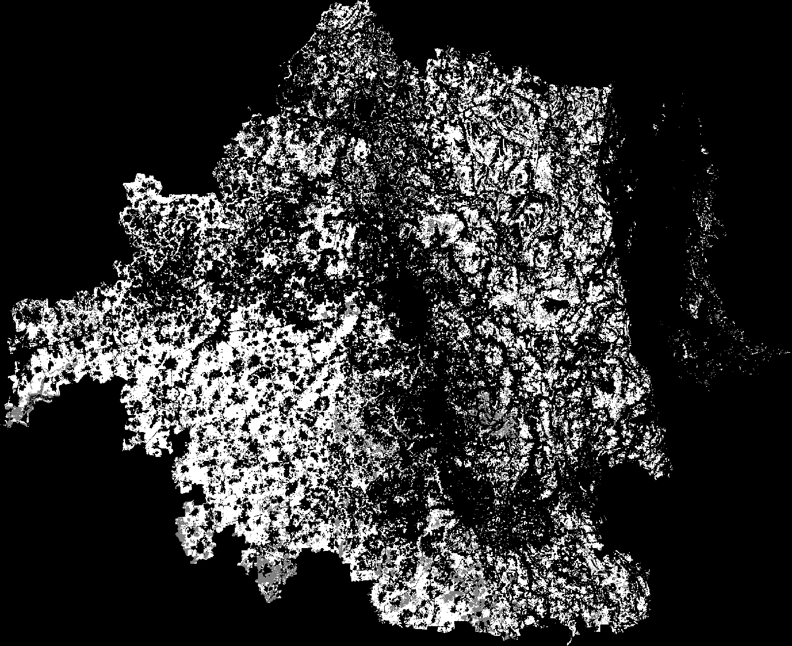
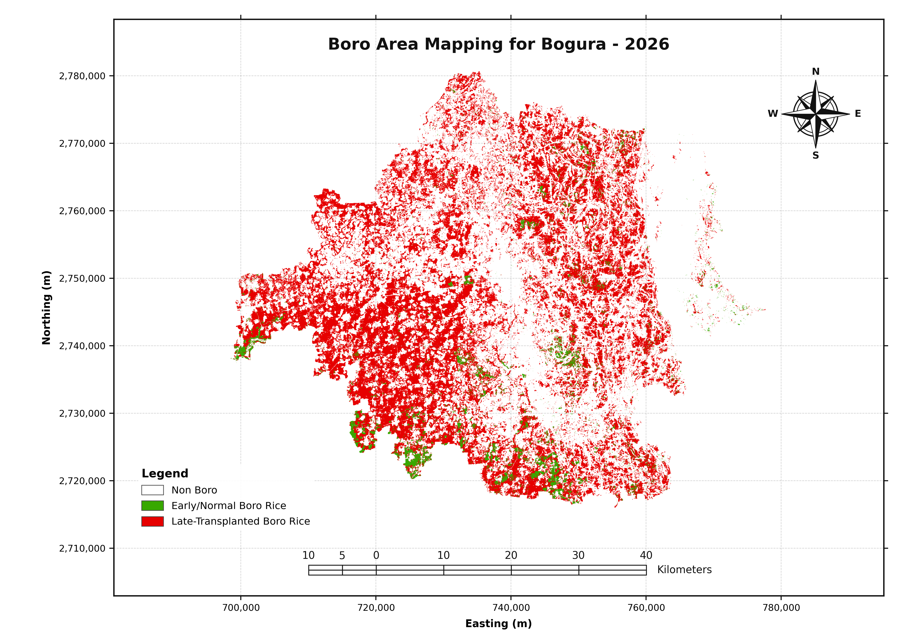

<p align="center">
  <a href="https://madeshchkma.github.io/LULCkit/">
    
  </a>
</p>

# LULCkit

[](https://www.python.org/downloads/)
[](LICENSE)
[](https://rasterio.readthedocs.io/)
[](https://pytorch.org/)
[](.github/workflows/ci.yml)
[](https://madeshchkma.github.io/LULCkit/)
[-ff9d00.svg)](https://huggingface.co/spaces/madeshchakma/LULCkit)

**`LULCkit`** is a fast, offline-capable command-line toolkit (invoked via `lulckit` or the short alias `lulc`) that turns any optical or pre-classified TIFF/GeoTIFF into **GIS-ready Land Use / Land Cover (LULC) maps, multiband composites, spectral indices, clipped rasters, interactive web maps, and complete metadata reports** — without needing ArcGIS or QGIS open.

> - **Browser GeoTIFF Studio (GitHub Pages):** https://madeshchkma.github.io/LULCkit/
> - **Cloud ML App (Hugging Face Spaces — ZeroGPU):** https://huggingface.co/spaces/madeshchakma/LULCkit
> - **QGIS Plugin (3.22+ / Qt6):** [qgis_plugin/README.md](qgis_plugin/README.md) (`Plugins → LULCkit` + Processing Toolbox)

---

## Key Features

- **Zero-Config Sensor Fingerprinting (`lulc inspect`)**: Profiles any TIFF/GeoTIFF (CRS, WKT/Proj4, affine transform, GSD in meters, WGS84 bounds/centroid, compression/tiling/COG layout, GDAL/TIFF tags, per-band statistics, and auto-detected sensor type).
- **Pretrained ML & Pre-Classified Support (`lulc map`)**:
  - **`rgb-oem`**: SegFormer-B4 (`nave1616/SegFormer-landcover-FT`, 9 OpenEarthMap classes) for high-res aerial, drone, satellite, or plain RGB TIFFs.
  - **`rgb-fast`**: Lightweight SegFormer-B0 (`florian-morel22/segformer-b0-deepglobe-land-cover`, 7 DeepGlobe classes) for fast CPU inference (or pass any custom Hugging Face SegFormer via `--hf-model`).
  - **`s2-dw`**: Bit-exact PyTorch Dynamic World (`calebrob6/dynamic_world_pytorch`, 9 classes) for 9–13 band Sentinel-2 10m scenes.
  - **`categorical`**: Zero-ML direct pass-through for pre-classified single-band integer GeoTIFFs (e.g., ESA WorldCover or custom crop maps) with embedded GDAL ColorTable and exact area analytics.
- **Band & Spectral Index Toolkit (`lulc bands`)**: Inspect band roles, extract/stretch any single band or custom 3-band RGB composite (`--composite`, `--rgb-bands`), or stream-compute `NDVI`, `NDWI`, `NDBI`, `SAVI`, and `EVI`.
- **GIS Cropping (`lulc clip`) & Batch Processing (`lulc batch`)**: Clip any GeoTIFF to a GeoJSON polygon boundary preserving colormaps and tags, or process entire directories of TIFFs in one command.
- **Guided Interactive Mode (`lulc wizard`)**: Step-by-step interactive prompts that configure your map and print the exact reproducible `lulc map` command.
- **Publication Print Cartography & GeoLibre-Inspired Web Maps**:
  - Full-page print layouts (`--page-size a4|a5|a3|letter|legal|square`, `--orientation auto|portrait|landscape`) with X/Y coordinate axes, 5 vector north arrow styles, ArcGIS-style scale bars, multicolor palettes, GeoJSON boundary overlays, and `png`/`pdf`/`svg` export at 300 DPI.
  - Self-contained interactive MapLibre GL JS HTML map (`--html`) with basemap switcher, opacity slider, legend, and live `Lon, Lat` readout.
- **Memory-Safe Streaming**: `O(1)`-RAM `rasterio` windowed inference with overlap halo discard (`tiling.py`) and exact geodesic area calculation (`pyproj.Geod`) for `EPSG:4326` rasters.

---

## Installation

### Standard / Editable Install

```bash
git clone https://github.com/madeshchkma/LULCkit.git
cd LULCkit

python -m venv --system-site-packages .venv
# Windows PowerShell:
.venv\Scripts\Activate.ps1
# Linux / macOS:
# source .venv/bin/activate

pip install -e ".[dev]"
```

Or with [`uv`](https://docs.astral.sh/uv/):

```bash
uv venv
uv pip install -e ".[dev]"
```

> **Note:** Installing registers both `lulckit` and `lulc` CLI commands. Pretrained model weights (`rgb-oem`, `rgb-fast`, `s2-dw`) are downloaded once on first use and cached locally (`~/.cache/lulckit/` and `~/.cache/huggingface/`), after which inference runs 100% offline.

### QGIS Plugin Install (QGIS 3.22+ / Qt6)

Build the installable plugin archive or install it directly into your local QGIS profile:

```bash
python scripts/build_qgis_plugin.py            # writes out/lulckit_qgis_v0.1.1.zip
python scripts/build_qgis_plugin.py --install  # copies lulckit_qgis/ to your QGIS plugins folder
```

See [qgis_plugin/README.md](qgis_plugin/README.md) for Processing Toolbox usage (`LULCkit`) and environment configuration.

---

## Quickstart

```bash
# 1. Inspect every metadata field, band statistic, and detected sensor profile
lulc inspect scene.tif

# 2. Run the guided interactive wizard (recommended for first-time use)
lulc wizard scene.tif

# 3. Auto-detect sensor & generate full LULC map + metadata bundle
lulc map scene.tif -o ./out/ --vector --html

# 4. List available models, palettes, composites, indices, arrows, and page sizes
lulc models
lulc styles
```

---

## Example: Bogura Boro Rice Mapping (10m GeoTIFF)

The repository bundles a real 10-meter pre-classified Cloud-Optimized GeoTIFF (`examples/bogura_boro_2026/Bogura_Boro_Map_10m_2026.tif`, `7,937 × 6,470 px`, `EPSG:32645`, `2.56 MB`, `categorical-classified`) so you can run every feature out of the box:

```bash
# Inspect full geospatial metadata & band statistics
lulc inspect examples/bogura_boro_2026/Bogura_Boro_Map_10m_2026.tif

# Render publication-ready A4 map, reports (CSV/JSON), GeoTIFF colormap, & HTML viewer
lulc map examples/bogura_boro_2026/Bogura_Boro_Map_10m_2026.tif \
  -o ./out/bogura \
  --title "Boro Area Mapping for Bogura - 2026" \
  --palette arcgis-crop \
  --class-labels "0:Non Boro,1:Early/Normal Boro Rice,2:Late-Transplanted Boro Rice" \
  --page-size a4 --arrow-style compass --scalebar-style arcgis --html
```

| Input: Raw GeoTIFF ([`Bogura_Boro_Map_10m_2026.tif`](examples/bogura_boro_2026/Bogura_Boro_Map_10m_2026.tif)) | Output: LULCkit Print Map ([`_preview.png`](examples/bogura_boro_2026/outputs/Bogura_Boro_Map_10m_2026_preview.png)) |
| :---: | :---: |
| [](examples/bogura_boro_2026/Bogura_Boro_Map_10m_2026.tif) | [](examples/bogura_boro_2026/outputs/Bogura_Boro_Map_10m_2026_preview.png) |
| *Raw 1-band `uint8` grayscale raster (values `0–2`, unstyled). Click image to view/download the `.tif`.* | *Auto-styled A4 map with UTM X/Y axes, compass rose, ArcGIS scale bar, legend, and embedded GeoTIFF ColorTable.* |

| Class ID | Class Name | Pixels | Share (%) | Area (ha) | Area (km²) |
| ---: | :--- | ---: | ---: | ---: | ---: |
| `0` | Non Boro (`#FFFFFF`) | 40,785,854 | 79.4235% | 407,858.54 | 4,078.59 |
| `1` | Early/Normal Boro Rice (`#38A800`) | 866,146 | 1.6867% | 8,661.46 | 86.61 |
| `2` | Late-Transplanted Boro Rice (`#E60000`) | 9,700,390 | 18.8899% | 97,003.90 | 970.04 |

Explore the full guide and sample outputs in [`examples/bogura_boro_2026/README.md`](examples/bogura_boro_2026/README.md): [Input GeoTIFF](examples/bogura_boro_2026/Bogura_Boro_Map_10m_2026.tif) · [Styled LULC GeoTIFF](examples/bogura_boro_2026/outputs/Bogura_Boro_Map_10m_2026_lulc.tif) · [CSV summary](examples/bogura_boro_2026/outputs/Bogura_Boro_Map_10m_2026_summary.csv) · [JSON report](examples/bogura_boro_2026/outputs/Bogura_Boro_Map_10m_2026_report.json) · [Interactive MapLibre HTML](examples/bogura_boro_2026/outputs/Bogura_Boro_Map_10m_2026_map.html).

---

## CLI Reference

| Command | Purpose | Example |
| :--- | :--- | :--- |
| `lulc inspect <tif>` | Full TIFF/GeoTIFF metadata, CRS, GSD, band stats, tags | `lulc inspect scene.tif --json` |
| `lulc bands <tif>` | Inspect bands, export custom RGB/single bands, compute indices | `lulc bands s2.tif --index ndvi -o ndvi.tif --preview-out ndvi.png` |
| `lulc clip <tif> <geojson>` | Clip GeoTIFF to a GeoJSON polygon boundary | `lulc clip scene.tif district.geojson -o clipped.tif` |
| `lulc map <tif>` | Classify or style any TIFF into GIS-ready LULC map + reports | `lulc map scene.tif -o ./out --page-size a4 --html` |
| `lulc batch <dir>` | Process a directory of `.tif`/`.tiff` files | `lulc batch ./tifs -o ./out --model rgb-fast` |
| `lulc wizard [tif]` | Guided interactive CLI setup + command generator | `lulc wizard` |
| `lulc models` | Show pretrained & pass-through models and local cache status | `lulc models` |
| `lulc styles` | List palettes, composites, indices, north arrows, scale bars, page sizes | `lulc styles` |

### Common Workflows

```bash
# Multiband false-color infrared composite & custom 3-band visualization
lulc bands sentinel2.tif --composite false-color-nir -o cir_map.png
lulc bands sentinel2.tif --rgb-bands 8,4,3 --page-size a4 -o custom_rgb.png
lulc bands sentinel2.tif --band 7 --palette viridis -o band7.png

# Stream-compute NDVI / NDWI / NDBI / SAVI / EVI to GeoTIFF + full-page figure
lulc bands sentinel2.tif --index ndvi -o ./out/ndvi.tif --preview-out ./out/ndvi.png

# Pre-classified single-band raster -> ArcGIS-style A4/A5 print PDF + interactive HTML
lulc map classified.tif -o ./out/ \
  --title "Boro Area Mapping - 2026" \
  --palette arcgis-crop \
  --class-labels "0:Non Boro,1:Early Boro,2:Late Boro" \
  --page-size a4 --arrow-style compass --scalebar-style arcgis \
  --map-format pdf --html

# High-res RGB GeoTIFF with fast CPU model + polygonized GeoJSON
lulc map drone_rgb.tif -o ./out/ --model rgb-fast --vector --save-confidence
```

---

## Output Bundle (`lulc map`)

| Artifact | Description |
| :--- | :--- |
| `<stem>_lulc.tif` | Single-band `uint8` compressed GeoTIFF (`nodata=255`) with embedded GDAL ColorTable & overviews |
| `<stem>_preview.<png\|pdf\|svg>` | Full-page print map (or side-by-side optical composite vs. LULC figure) at configurable DPI |
| `<stem>_report.json` | Complete machine-readable report (file metadata, CRS, GSD, band stats, spectral indices, areas) |
| `<stem>_summary.csv` | Per-class pixel counts, percentages, m², ha, km², and mean confidence |
| `<stem>_lulc.geojson` | Optional polygonized RFC 7946 GeoJSON in WGS84 (`--vector`) |
| `<stem>_confidence.tif` | Optional `uint8` (`0–100%`) per-pixel prediction confidence GeoTIFF (`--save-confidence`) |
| `<stem>_map.html` | Optional self-contained MapLibre GL JS interactive web map (`--html`) |

---

## Web Hosting (GitHub Pages + Hugging Face Spaces)

- **GitHub Pages Static Website & Client-Side Browser Studio ([`docs/`](docs/)):** Hosted free at https://madeshchkma.github.io/LULCkit/ via [`.github/workflows/pages.yml`](.github/workflows/pages.yml). Visitors can drop any `.tif` file into their browser to inspect metadata, style categorical classes, compute `NDVI`/`NDWI`/`NDBI`, view MapLibre overlays, and download high-res PNG/CSV/JSON outputs with zero server needed.
- **Hugging Face Spaces Gradio App ([`spaces/`](spaces/)):** Live on ZeroGPU at https://huggingface.co/spaces/madeshchakma/LULCkit (source files: [`spaces/app.py`](spaces/app.py), [`spaces/requirements.txt`](spaces/requirements.txt), [`spaces/README.md`](spaces/README.md)) for server-side PyTorch SegFormer (`rgb-oem`, `rgb-fast`) and Sentinel-2 Dynamic World (`s2-dw`) inference.

---

## Project Architecture

```text
LULCkit/
├── .github/                  # CI and GitHub Pages workflows + issue/PR templates
├── docs/                     # GitHub Pages website & client-side Browser GeoTIFF Studio
├── examples/
│   └── bogura_boro_2026/     # Bundled 10m COG GeoTIFF sample & rendered outputs
├── spaces/                   # Gradio app ready for Hugging Face Spaces deployment
├── src/lulckit/
│   ├── __init__.py           # Package version
│   ├── cli.py                # Typer CLI commands & Rich help panels
│   ├── inspect.py            # Metadata profiling, band stats, sensor fingerprinting
│   ├── geo.py                # Geodesic/projected pixel areas, GSD, RGB stretch, indices
│   ├── bands.py              # Band composites, spectral index streaming, GeoJSON clipping
│   ├── cartography.py        # Palettes, north arrows, scale bars, print layout, HTML map
│   ├── tiling.py             # O(1)-RAM windowed inference with overlap halo discard
│   ├── outputs.py            # JSON/CSV/GeoJSON/Rich terminal reporting
│   └── models/
│       ├── base.py           # BaseLULCModel, ClassSpec, canonical GIS colors
│       ├── categorical.py    # Zero-ML pre-classified GeoTIFF adapter
│       ├── hf_segformer.py   # Hugging Face SegFormer adapter (rgb-oem, rgb-fast)
│       ├── s2_dw.py          # PyTorch Dynamic World Sentinel-2 adapter
│       └── router.py         # Model registry, cache inspection, auto-routing
└── tests/
    └── test_pipeline.py      # Offline unit & integration suite
```

---

## Development & Testing

```bash
# Run full offline unit & integration suite
pytest -v

# Lint with ruff
ruff check src tests
```

See [CONTRIBUTING.md](CONTRIBUTING.md) for guidelines and [NOTICE](NOTICE) for third-party model and software attributions.
