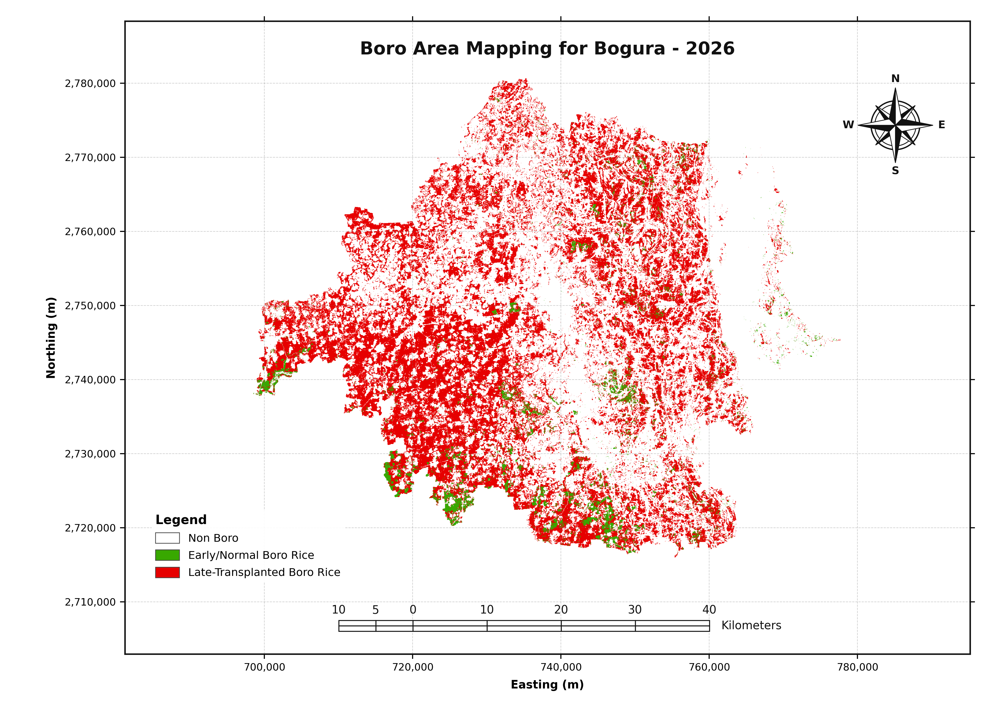

# Bogura District Boro Rice Mapping (2026) — Example GeoTIFF

This example demonstrates running `LULCkit` (`lulckit` / `lulc`) on a real 10-meter single-band pre-classified Cloud-Optimized GeoTIFF (`Bogura_Boro_Map_10m_2026.tif`).



## Included Dataset Specifications

| Property | Value |
| :--- | :--- |
| **Input File** | `examples/bogura_boro_2026/Bogura_Boro_Map_10m_2026.tif` (`2.56 MB`) |
| **Format / Layout** | Cloud-Optimized GeoTIFF (`GTiff`, `LZW`, `256×256` tiles, overviews `[2, 4, 8, 16, 32]`) |
| **Dimensions** | `7,937 × 6,470 px` (`51,352,390 px` total) |
| **Band** | `1` band (`uint8`, `Boro_Class`, values `{0, 1, 2}`, `nodata=None`) |
| **CRS / Projection** | `EPSG:32645` (`WGS 84 / UTM zone 45N`) |
| **Spatial Resolution (GSD)** | `10.0 × 10.0 m/px` |
| **WGS84 Centroid** | `89.3576176°E, 24.830086°N` |
| **Total Raster Area** | `513,523.90 ha` (`5,135.239 km²`) |
| **Detected Profile** | `categorical-classified` (zero-ML pass-through + GDAL ColorTable & exact area analytics) |

---

## Reproduce These Outputs

Run from the repository root:

```bash
# 1. Inspect metadata, CRS, GSD, band stats, and detected sensor profile
lulc inspect examples/bogura_boro_2026/Bogura_Boro_Map_10m_2026.tif

# 2. Generate the full-page A4 print map PNG, GeoTIFF with ColorTable, CSV/JSON reports, and HTML web map
lulc map examples/bogura_boro_2026/Bogura_Boro_Map_10m_2026.tif \
  -o ./out/bogura \
  --title "Boro Area Mapping for Bogura - 2026" \
  --palette arcgis-crop \
  --class-labels "0:Non Boro,1:Early/Normal Boro Rice,2:Late-Transplanted Boro Rice" \
  --page-size a4 \
  --arrow-style compass \
  --scalebar-style arcgis \
  --html
```

### Additional Page Size & Format Variants

```bash
# A5 compact print sheet
lulc map examples/bogura_boro_2026/Bogura_Boro_Map_10m_2026.tif \
  -o ./out/bogura_a5 --page-size a5 --palette arcgis-crop \
  --class-labels "0:Non Boro,1:Early/Normal Boro Rice,2:Late-Transplanted Boro Rice" \
  --title "Boro Area Mapping for Bogura - 2026"

# A4 Portrait print sheet
lulc map examples/bogura_boro_2026/Bogura_Boro_Map_10m_2026.tif \
  -o ./out/bogura_portrait --page-size a4 --orientation portrait --palette arcgis-crop \
  --class-labels "0:Non Boro,1:Early/Normal Boro Rice,2:Late-Transplanted Boro Rice" \
  --title "Boro Area Mapping for Bogura - 2026"

# Publication vector PDF export (300 DPI)
lulc map examples/bogura_boro_2026/Bogura_Boro_Map_10m_2026.tif \
  -o ./out/bogura_pdf --page-size a4 --map-format pdf --palette arcgis-crop \
  --class-labels "0:Non Boro,1:Early/Normal Boro Rice,2:Late-Transplanted Boro Rice" \
  --title "Boro Area Mapping for Bogura - 2026"
```

---

## Class Area Breakdown

Generated from [`outputs/Bogura_Boro_Map_10m_2026_summary.csv`](outputs/Bogura_Boro_Map_10m_2026_summary.csv):

| Class ID | Label | Color | Pixels | Share (%) | Area (ha) | Area (km²) |
| ---: | :--- | :--- | ---: | ---: | ---: | ---: |
| `0` | Non Boro | `#FFFFFF` | 40,785,854 | 79.4235% | 407,858.54 | 4,078.59 |
| `1` | Early/Normal Boro Rice | `#38A800` | 866,146 | 1.6867% | 8,661.46 | 86.61 |
| `2` | Late-Transplanted Boro Rice | `#E60000` | 9,700,390 | 18.8899% | 97,003.90 | 970.04 |

## Bundled Sample Outputs

- [Print Map PNG (`300 DPI`, A4 Landscape)](outputs/Bogura_Boro_Map_10m_2026_preview.png)
- [Area Summary CSV](outputs/Bogura_Boro_Map_10m_2026_summary.csv)
- [Full Metadata & Analytics JSON](outputs/Bogura_Boro_Map_10m_2026_report.json)
- [Interactive MapLibre GL JS Web Map (HTML)](outputs/Bogura_Boro_Map_10m_2026_map.html)
